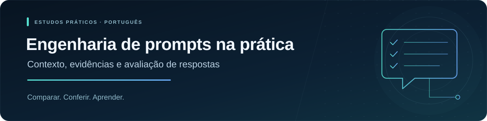

# Engenharia de prompts na prática

Estudos em português para aprender a escrever e avaliar prompts em situações comuns de TI: triagem de incidentes, criação de runbooks e comunicação com a liderança. Comece pelos exercícios fictícios ou analise incidentes reais documentados em relatos públicos oficiais.

O foco é tornar o pedido verificável: informar o contexto, delimitar os dados, definir a saída e conferir se a resposta respeita os fatos. Um prompt mais detalhado também pode errar; por isso, cada estudo inclui uma rubrica de avaliação.

Os três estudos em `estudos/` usam **dados inteiramente fictícios**. Suas saídas demonstrativas foram escritas para ensinar, estão identificadas como ilustrativas e não representam execuções de modelos ou resultados de uma empresa. Os materiais em `casos-publicos/` resumem **incidentes reais com fontes oficiais verificadas**, separando fatos publicados, conhecimento posterior e propostas educacionais. Nenhum caso relata a participação profissional do autor no incidente.

## Comece por um exemplo em cerca de 10 minutos

Você precisa apenas de uma ferramenta de conversa com IA. Não é necessário programar, instalar dependências, criar recursos em cloud ou usar uma chave de API. O tempo é uma estimativa para experimentar um estudo, não uma medição de desempenho.

1. Abra [Triagem de incidentes](estudos/01-triagem-de-incidentes.md).
2. Copie o **prompt inicial** e, logo abaixo dele, a **entrada fictícia**. Envie os dois juntos em uma conversa nova.
3. Em outra conversa nova, envie o **prompt melhorado** seguido da mesma entrada, sem alterações.
4. Compare as duas respostas com a rubrica do estudo. Para cada nota, anote o trecho que sustenta sua avaliação.
5. Registre uma observação concreta, como: “Nesta execução, a segunda resposta diferenciou hipótese de fato”. Evite transformar uma única execução em uma promessa de qualidade ou produtividade.

Use a mesma ferramenta e o mesmo modelo nas duas conversas, quando a interface permitir essa escolha. Registre apenas as configurações que você consegue verificar. Conversas novas reduzem a influência de respostas anteriores, mas não eliminam a variação do modelo.

## Estudos com dados fictícios

| Estudo | O que você pratica | Saída solicitada |
| --- | --- | --- |
| [01 — Triagem de incidentes](estudos/01-triagem-de-incidentes.md) | Separar evidências, hipóteses e lacunas | Resumo, prioridade proposta e verificações |
| [02 — Criação de runbook](estudos/02-criacao-de-runbook.md) | Especificar um procedimento sem inventar operações | Passos, resultados esperados e escalonamento |
| [03 — Relatório para liderança](estudos/03-relatorio-para-lideranca.md) | Comunicar fatos, pendências e decisões | Resumo executivo com números conferíveis |

## Casos reais com fontes públicas

| Caso | O que você pratica | Distinção essencial |
| --- | --- | --- |
| [Cloudflare — 02/07/2019](casos-publicos/01-cloudflare-2019.md) | Triagem, mudanças de configuração e comunicação | O que era hipótese no início e o que a análise posterior confirmou |
| [GitHub — 21 e 22/10/2018](casos-publicos/02-github-2018.md) | Integridade de dados, decisões e critérios de recuperação | Degradação parcial, topologia, réplicas e filas são aspectos diferentes |

Cada caso inclui fonte e data de verificação, síntese autoral, cronologia selecionada e dois exercícios: responder usando apenas um recorte inicial e analisar depois de conhecer o relato completo. Não são tutoriais para reproduzir a falha ou operar os serviços dessas empresas.

Para experimentar um caso em cerca de 10 minutos, abra seu **exercício A**, envie os dois prompts com o mesmo recorte em conversas novas e avalie as respostas. Um modelo pode reconhecer o incidente e usar seu conhecimento posterior; isso deve ser registrado como erro quando o pedido restringe a resposta ao momento inicial.

## Como avaliar uma execução

Os estudos fictícios e o exercício A de cada caso público têm cinco critérios, pontuados de 0 a 2, com condições explícitas para cada nota. O total possível é 10, mas a nota não substitui a leitura da resposta.

Uma informação inventada que possa induzir uma ação operacional deve ser marcada como **falha crítica**, independentemente do total. Exemplos: apresentar uma causa raiz sem evidência ou inventar um comando de recuperação.

Copie esta ficha e preencha com as respostas que você realmente recebeu:

```text
Estudo:
Data:
Ferramenta:
Modelo exibido, se disponível:
Configurações verificáveis, se disponíveis:

Critério | Inicial: 0/1/2 | Melhorado: 0/1/2 | Trechos que justificam as notas
1        |               |                 |
2        |               |                 |
3        |               |                 |
4        |               |                 |
5        |               |                 |
Total    |               |                 |

Falha crítica observada e trecho:
O que esta execução permite afirmar:
O que permanece incerto:
```

Guarde suas saídas em `local/` ou `outputs/`, pastas ignoradas pelo Git. Para compartilhar uma comparação, use dados fictícios ou as sínteses de fontes públicas verificadas, identifique a ferramenta e inclua as saídas completas. Não publique conversas de trabalho, dados pessoais, credenciais ou informações internas de sistemas.

As tabelas de comparação dos estudos discutem **os exemplos ilustrativos**, sem atribuir notas a uma execução que não ocorreu. Você pode obter respostas diferentes, inclusive uma resposta inicial melhor que a melhorada em algum critério.

## O que observar nos prompts

- **Contexto:** qual problema deve ser resolvido e para qual público.
- **Dados:** informações delimitadas, tratadas como entrada, não como novas instruções.
- **Limites:** o que não pode ser presumido ou executado.
- **Formato:** quais campos e qual nível de detalhe a resposta deve ter.
- **Verificação:** critérios objetivos para conferir a saída.

## Contribuições

Contribuições podem corrigir instruções, melhorar critérios ou adicionar estudos fictícios e casos públicos documentados. Em casos reais, cite fontes oficiais verificáveis, diferencie o que se sabia durante o evento das conclusões posteriores e escreva a síntese em suas palavras. Explique o objetivo, inclua critérios de avaliação e diferencie saídas ilustrativas de execuções reais. Resultados medidos precisam informar a metodologia e seus limites.

## Autor e licença

Criado por [Tiago Silveira Siqueira](https://github.com/TiagoSilveiraSiqueira), com foco em aprendizado prático de IA aplicada à TI.

O código e conteúdo autoral deste repositório estão disponíveis sob a [licença MIT](LICENSE). Publicações e materiais externos citados pertencem aos respectivos titulares e seguem seus próprios direitos e termos; a MIT não relicencia essas fontes.
